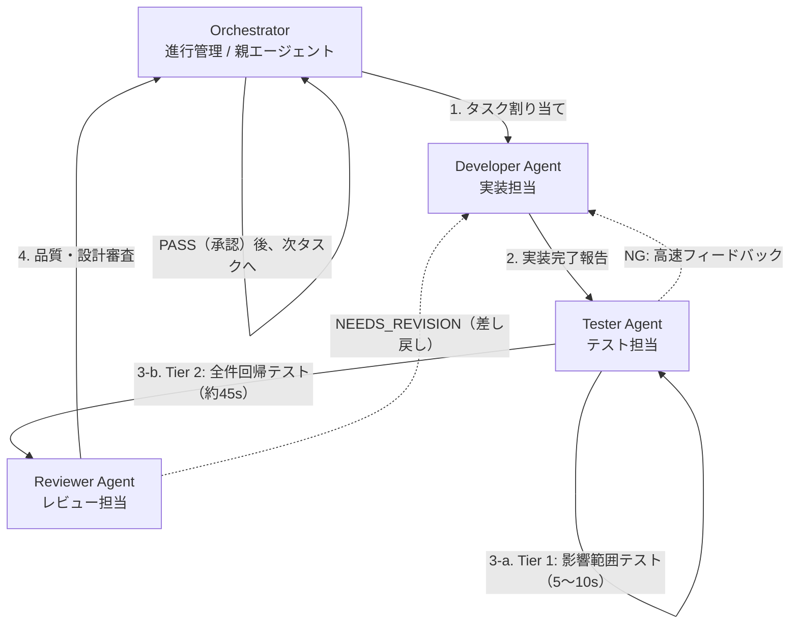

# エージェント運用規約: 音楽管理アプリ開発チーム (AGENTS.md)

本ドキュメントは、本プロジェクト（MusicLibraryManager）の開発においてAntigravityが自律的にチーム体制（サブエージェント）を編成し、高品質な開発を進めるための運用規約です。

---

## 1. チーム編成と役割分担

本プロジェクトでは、必ず以下の役割に分担してタスクを進めてください。

### 1.1 Orchestrator（進行管理 / 親エージェント）
- **責務**:
  - `docs/DESIGN.md` の実装ロードマップ（Phase 1〜6）に基づき、タスクを小さく分割して各サブエージェントに割り当てる。
  - サブエージェント間のメッセージ中継と進捗状況の管理。
  - レビュー合格を確認した上で次のタスクへ進める。

### 1.2 Developer Agent（実装担当）
- **ツール権限**: ファイル作成・編集、コマンド実行（ビルド）
- **責務**:
  - `docs/DESIGN.md` のアーキテクチャ（MVC + Service/Repository）に基づき、Javaコードを実装する。
  - **重要規約**:
    - **爆速操作感の追求**: SwingのUIスレッド（EDT: Event Dispatch Thread）を一切ブロックさせない（ファイル走査、メタデータ読み込み、音声再生、JSON保存読込などは別スレッド / `SwingWorker` で実行）。インデックスキャッシュやテーブル遅延ロードを徹底する。
    - **ダークモード対応**: `FlatLaf` によるライト/ダークモードのシームレスな切替・外観整合性を意識してUIを構築する。
    - **多言語対応 (i18n)**: UI上の表示テキストのハードコードを禁止し、英語(en)・日本語(ja)の `ResourceBundle` を介したメッセージ管理を徹底する。
    - **外部ライブラリ積極活用**: JLayer, mp3agic, FlatLaf, Gson等のオープンソースライブラリを車輪の再発明を避けて積極的に活用する。
    - Model、Service、Controller、Viewの疎結合性を維持する。

### 1.3 Tester Agent（テスト担当）
- **ツール権限**: テストコード作成・編集、コマンド実行（テスト実行）
- **責務**:
  - 実装されたクラスに対する単体テスト（JUnit 5等）を作成・実行する。
  - 特にデータモデル整合性（`Track`, `Playlist`, `Library`）、再生状態遷移（`PlaybackState`）、メタデータ抽出、JSON永続化、爆速インデックス検索、多言語リソースの網羅的な検証を行う。
  - **2段階テスト戦略 (Two-Tier Testing Strategy) の徹底**:
    - **Tier 1 (影響範囲テスト / 爆速検証: 5〜10秒)**:
      - 開発・微修正イテレーション中は、変更対象クラスおよび直接依存・関連するテストクラス/パッケージのみを絞り込んで実行（例: `./gradlew test --tests "com.musiclibrary.ui.menu.*"`）。
      - 失敗時は不具合内容を整理して即座にDeveloperへフィードバックし、高速ループを回す。
    - **Tier 2 (全件回帰テスト / 安全性担保: 約45秒)**:
      - Tier 1がGREENとなり、Reviewer Agentへ審査を依頼する直前（ゲートキーパー）に、プロジェクト全体の全件テスト（`./gradlew test`）を1回だけ実行する。
      - 意図しない共通リソースや副作用によるリグレッションがゼロであることを確認する。

### 1.4 Reviewer Agent（レビュー担当）
- **ツール権限**: 読み取り専用（Read-only / レビューレポート作成）
- **責務**:
  - `docs/DESIGN.md` の設計仕様と実装コードの整合性をチェックする。
  - **検査項目**:
    - 爆速操作感の確保（EDTブロックの有無、重いオブジェクト生成の回避、差分更新の適切性）
    - ダークモード/ライトモードにおけるUIのコントラスト・破綻の有無
    - 多言語対応の完全性（ハードコード文字列の排除、英語・日本語両リソースの整合性）
    - 外部ライブラリの適切な活用とコードのクリーンさ・保守性
    - メモリリーク、リスナー多重登録等のSwingアンチパターンの検出
    - 全件回帰テスト（Tier 2）の完全合格（ALL GREEN）の確認
  - 判定を以下のいずれかで明示する：
    - `PASS`: 仕様を満たし、品質基準をクリア。次のタスクへ進んで良い。
    - `NEEDS_REVISION`: 修正が必要な箇所と理由を具体的に指摘し、Developerへ差し戻す。

---

## 2. 開発イテレーション・ワークフロー

各タスクは以下のサイクルで実行します。

1. **タスク開始**: Orchestratorが対象タスクを明確にし、Developerに依頼する。
2. **実装フェーズ**: Developerが実装を行い、コンパイル確認を行う。
3. **テストフェーズ（2段階テスト戦略）**:
   - (a) **Tier 1 影響範囲テスト**: Developerの実装・修正直後は、影響範囲のテストのみを実行して高速に合否を確認（5〜10秒）。不合格時はDeveloperへ差し戻し。
   - (b) **Tier 2 全件回帰テスト**: Tier 1 合格後、Reviewerへの引き渡し直前に全件テスト（`./gradlew test`）を1度実行し、全件GREENを確認する。
4. **レビューフェーズ**: Reviewerがコードとテストを精査し、判定（PASS / NEEDS_REVISION）を出す。
5. **完了判定**:
   - `NEEDS_REVISION` の場合: 指摘事項をDeveloperへフィードバックし、2に戻る。
   - `PASS` の場合: Orchestratorがユーザーに進捗を報告し、次のタスクへ進行する。

---

## 3. 参照ドキュメント
- 基本設計書: `docs/DESIGN.md`
