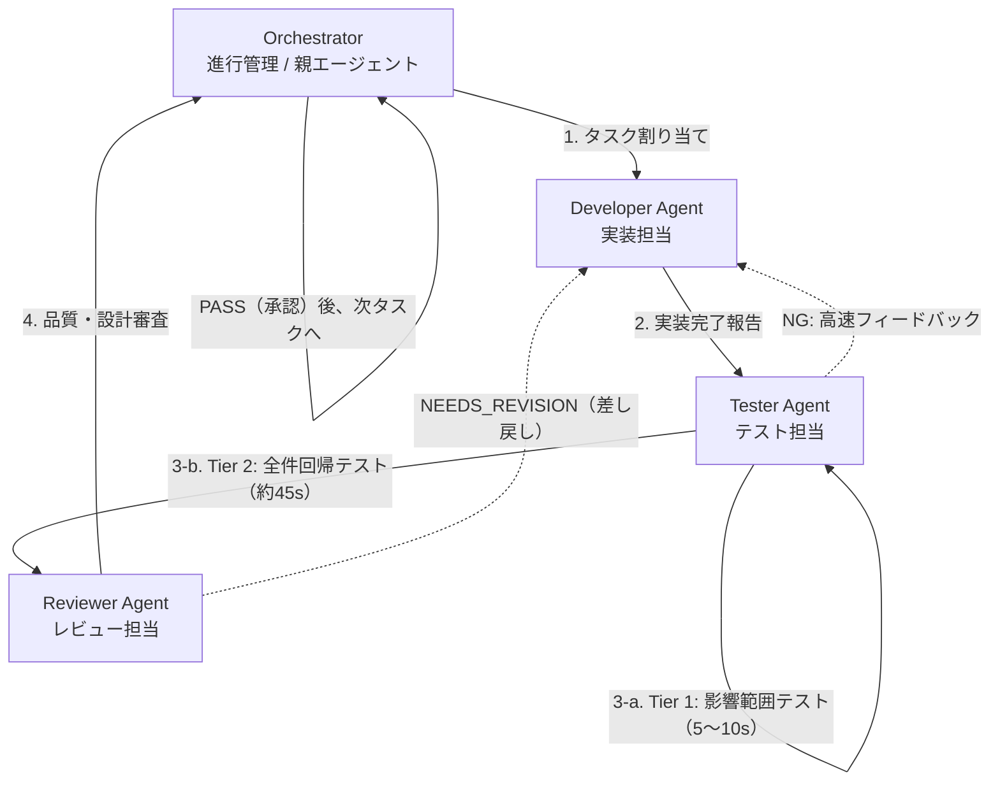

# エージェント運用規約: 音楽管理アプリ開発チーム (AGENTS.md)

本ドキュメントは、本プロジェクト（MusicLibraryManager）の開発においてAntigravityが自律的にチーム体制（サブエージェント）を編成し、高品質な開発を進めるための運用規約です。

---

## 1. チーム編成と役割分担

本プロジェクトでは、必ず以下の役割に分担してタスクを進めてください。



### 1.1 Orchestrator（進行管理 / 親エージェント）
- **責務**:
  - `docs/DESIGN.md` の実装ロードマップ（Phase 1〜6）に基づき、タスクを小さく分割して各サブエージェントに割り当てる。
  - サブエージェント間のメッセージ中継と進捗状況の管理。
  - レビュー合格を確認した上で次のタスクへ進める。

### 1.2 Developer Agent（実装担当）
- **ツール権限**: ファイル作成・編集、コマンド実行（ビルド）
- **責務**:
  - `docs/DESIGN.md` のアーキテクチャ（MVC + Service/Repository）に基づき、Javaコードを実装する。
  - **重要規約**:
    - **爆速操作感の追求**: SwingのUIスレッド（EDT: Event Dispatch Thread）を一切ブロックさせない（ファイル走査、メタデータ読み込み、音声再生、JSON保存読込などは別スレッド / `SwingWorker` で実行）。インデックスキャッシュやテーブル遅延ロードを徹底する。
    - **ダークモード対応**: `FlatLaf` によるライト/ダークモードのシームレスな切替・外観整合性を意識してUIを構築する。
    - **多言語対応 (i18n)**: UI上の表示テキストのハードコードを禁止し、英語(en)・日本語(ja)の `ResourceBundle` を介したメッセージ管理を徹底する。
    - **外部ライブラリ積極活用**: JLayer, mp3agic, FlatLaf, Gson等のオープンソースライブラリを車輪の再発明を避けて積極的に活用する。
    - Model、Service、Controller、Viewの疎結合性を維持する。
    - **デグレ（機能退行・UI操作ロック）防止の徹底**:
      - `JSplitPane` やリサイズ可能ペイン等を実装・変更する際は、子コンポーネントの `MinimumSize`（例: `WrapLayout` や `JTable` のデフォルト最小幅）やイベントリスナー内のサイズ変更（ドラッグ中の `setPreferredSize` 等）によってディバイダーの可動域がロックされないよう必ず配慮する。
      - 既存コンポーネント（`TrackTablePanel` 等）の表示モード拡張や改修を行う際は、以下の「機能横断マトリクス（全12項目）」の既存機能が一切損なわれないことを確認して実装する。

### 1.3 Tester Agent（テスト担当）
- **ツール権限**: テストコード作成・編集、コマンド実行（テスト実行）
- **責務**:
  - 実装されたクラスに対する単体テスト（JUnit 5等）を作成・実行する。
  - 特にデータモデル整合性（`Track`, `Playlist`, `Library`）、再生状態遷移（`PlaybackState`）、メタデータ抽出、JSON永続化、爆速インデックス検索、多言語リソースの網羅的な検証を行う。
  - **実操作・UI不変条件（Invariants）検証によるデグレ防止の徹底**:
    - 単なる設定値の getter/setter 検証にとどまらず、Swing コンポーネントに実際のサイズを与えてレイアウトした状態（`setSize` + `doLayout`）で、**ユーザーが実際に操作できるか**を検証するテストを必須とする。
  - **機能横断テストマトリクス（Cross-Feature Test Matrix: 全12項目）の義務化**:
    - 画面・テーブル・ペイン・表示モードを新設または改修した際は、新機能単体の正常系テストだけでなく、既存の他機能と掛け合わせた以下の全12項目を**初回テスト作成時に必ず網羅**し、Tier 1 / Tier 2 の自動検証に乗せること：
      1. **再生連携**: 再生・一時停止・停止時のアイコン（`PlaybackStatusIcon`）と状態同期、トラック番号等の既存表示との両立。
      2. **リンク切れ（Missing）**: リンク切れ曲の `⚠️` 表示・赤文字・ツールチップ・再リンク時の表示更新。
      3. **データ変更 & コンテキストメニュー（CRUD）**: その画面上での曲削除（`Delete`）・タグ編集（`Ctrl+I`）後のキャッシュ更新順序、選択状態の維持、カード・ヘッダー・曲一覧の即時更新（全曲削除時のクリアを含む）。右クリックポップアップメニューの全アクション（再生、次に再生、プレイリストに追加、情報を見る、ファイルの場所を開く、ライブラリから削除）が単一・複数選択の双方で例外なく安全に動作すること。
      4. **インポート・再スキャン**: バックグラウンドインポート中（`onBatchImported`）に無関係な曲が混入しないこと、および完了時の表示整合性。
      5. **検索・フィルタ**: 検索バー入力・クリア時の絞り込みと選択状態の維持/解除の整合性。
      6. **レイアウト・操作性**: 分割ペイン（`JSplitPane`）の可動域がロックされていないこと（`getMinimumDividerLocation() < getMaximumDividerLocation()`）、左右双方向への移動・幅記憶、スクロール位置・カラム設定の退避と復元。
      7. **表示切替**: セクション間の往復遷移（アルバム ⇔ アーティスト ⇔ すべての曲 ⇔ プレイリスト）、ダーク/ライトテーマ切替、日英言語切替後の状態維持。
      8. **ドラッグ＆ドロップ（D&D）**: テーブル（標準/2行モード）からサイドバープレイリストへのトラックD&D、およびOSからのファイル/フォルダD&Dインポートが正常に受け付けられること。
      9. **キーボード操作 & グローバルショートカット**: 矢印キー移動、`Space`（再生/一時停止）、`Enter`（再生）、`Delete`（削除）、`Ctrl+I`（情報）。ペイン・テーブルにフォーカスがある状態でも `Ctrl+F`（検索）、`Ctrl+M`（ミニプレーヤー）、`Ctrl+T`（テーマ切替）等のグローバルキーが遮断されずに発火すること。
      10. **再生キュー & 連続再生コンテキスト**: ビュー内で曲をダブルクリック（またはヘッダー再生）した際、その画面の曲順で再生キュー（`PlayQueue`）が構築され、曲終了後に同一画面内の次曲へ自動連続再生されること。右クリック「次に再生」の割り込み挿入整合性。
      11. **ミニプレーヤー切り替え・復帰**: `Ctrl+M` やボタンでミニプレーヤー化し、メインウィンドウへ復帰（`restoreFromMiniPlayer`）した際に、元の画面の表示モード、選択状態、スクロール位置、分割ペイン幅、再生状態が完全に復元されること。
      12. **マルチアカウント切り替え**: アカウント切り替え時（`switchAccount`）、表示中ペインのキャッシュや表示が新アカウントのライブラリ内容で即座に再構築され、前アカウントのデータ残存（ゴースト表示・メモリリーク）が発生しないこと。
  - **2段階テスト戦略 (Two-Tier Testing Strategy) の徹底**:
    - **Tier 1 (影響範囲テスト / 爆速検証: 5〜10秒)**:
      - 開発・微修正イテレーション中は、変更対象クラスおよび直接依存・関連するテストクラス/パッケージのみを絞り込んで実行（例: `./gradlew test --tests "com.musiclibrary.ui.menu.*"`）。
      - 失敗時は不具合内容を整理して即座にDeveloperへフィードバックし、高速ループを回す。
    - **Tier 2 (全件回帰テスト / 安全性担保: 約45秒)**:
      - Tier 1がGREENとなり、Reviewer Agentへ審査を依頼する直前（ゲートキーパー）に、プロジェクト全体の全件テスト（`./gradlew test`）を1回だけ実行する。
      - 意図しない共通リソースや副作用によるリグレッションがゼロであることを確認する。

### 1.4 Reviewer Agent（レビュー担当）
- **ツール権限**: 読み取り専用（Read-only / レビューレポート作成）
- **責務**:
  - `docs/DESIGN.md` の設計仕様と実装コードの整合性をチェックする。
  - **検査項目**:
    - 爆速操作感の確保（EDTブロックの有無、重いオブジェクト生成の回避、差分更新の適切性）
    - ダークモード/ライトモードにおけるUIのコントラスト・破綻の有無
    - 多言語対応の完全性（ハードコード文字列の排除、英語・日本語両リソースの整合性）
    - 外部ライブラリの適切な活用とコードのクリーンさ・保守性
    - メモリリーク、リスナー多重登録等のSwingアンチパターンの検出
    - **デグレ・UI操作ロック・機能横断マトリクスの厳格監査**: 変更によって既存のUI操作や「機能横断テストマトリクス（全12項目）」の整合性が損なわれていないか、および**それらを実レイアウト状態で検証する回帰テストが漏れなく実装されているか**を確認する（マトリクス項目の実装または実操作レベルのテストが1つでも不足している場合は無条件で `NEEDS_REVISION` とする）。
    - 全件回帰テスト（Tier 2）の完全合格（ALL GREEN）の確認
  - 判定を以下のいずれかで明示する：
    - `PASS`: 仕様を満たし、品質基準をクリア。次のタスクへ進んで良い。
    - `NEEDS_REVISION`: 修正が必要な箇所と理由を具体的に指摘し、Developerへ差し戻す。

---

## 2. 開発イテレーション・ワークフロー（Feature Branch 運用）

本プロジェクトでは、変更の安全性とGit履歴の可読性を高めるため、タスクごとに作業ブランチ（フィーチャーブランチ）を作成して開発・検証を進め、完了後に `master` へマージする運用を徹底します。

```mermaid
gitGraph
   commit id: "master"
   branch feature/xxx
   checkout feature/xxx
   commit id: "Developer実装"
   commit id: "Tier 1 & Tier 2 テスト"
   commit id: "Reviewer合格"
   checkout master
   merge feature/xxx id: "masterマージ"
```

各タスクは以下のサイクルで実行します。

1. **作業ブランチの作成（Orchestrator）**:
   - `master` ブランチを最新状態にした上で、タスク内容を表すブランチを作成・チェックアウトする（例: `feature/xxx`, `fix/xxx`, `refactor/xxx`）。
   - タスクを明確化し、Developer Agent へ依頼する。
2. **実装フェーズ（Developer Agent）**:
   - 作業ブランチ上で `docs/DESIGN.md` の設計仕様に従い実装を行う。
   - コンパイル確認（`./gradlew compileJava`）を行う。
3. **テストフェーズ（Tester Agent: 2段階テスト戦略）**:
   - (a) **Tier 1 影響範囲テスト**: Developerの実装・修正直後は、影響範囲のテストのみを実行して高速に合否を確認（5〜10秒）。不合格時はDeveloperへ差し戻し。
   - (b) **Tier 2 全件回帰テスト**: Tier 1 合格後、Reviewerへの引き渡し直前に全件テスト（`./gradlew test`）を1度実行し、全件GREENを確認する。
4. **レビューフェーズ（Reviewer Agent）**:
   - 作業ブランチ上のコードとテストを精査し、判定（PASS / NEEDS_REVISION）を出す。
5. **ユーザー確認 & マージフェーズ（Orchestrator）**:
   - `NEEDS_REVISION` の場合: 指摘事項をDeveloperへフィードバックし、2に戻る。
   - `PASS` の場合:
     1. ユーザーへ作業ブランチでの完了報告を行い、動作確認を依頼する。
     2. ユーザー確認OK後、作業ブランチの変更をコミットし、`master` ブランチへマージ（`git checkout master && git merge <branch>`）する。
     3. マージ完了後、役目を終えた作業ブランチを削除する（`git branch -d <branch>`）。

---

## 3. 参照ドキュメント
- 基本設計書: `docs/DESIGN.md`
