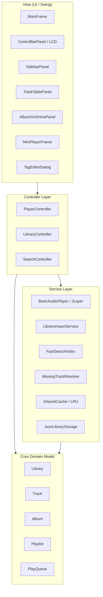

# Music Library Manager 🎵

[](https://www.oracle.com/java/technologies/downloads/#java21)
[](https://gradle.org/)
[](https://opensource.org/licenses/MIT)
[]()

クラシックな **iTunes（Windows版/Mac版）の洗練された操作感** を再現しつつ、従来の iTunes が抱えていた動作の重さやファイル改変などの弱点を根本から克服した、デスクトップ向け超高速音楽管理・再生アプリケーションです。

---

## 🌟 主な特徴と差別化機能

### 1. ⚡ 音楽再生・管理への極限の純化（超軽量・爆速操作感）
- **不要な外部同期・ストアの完全排除**: ローカル音楽ファイルの再生と管理に純化。
- **UIスレッド（EDT）ブロック 0ミリ秒の徹底**:
  - 58,000曲規模の膨大なライブラリでも、メモリ消費はわずか100MB以下。
  - `FastSearchIndex` による **1ms未満のインクリメンタル高速検索**。
  - アートワークの遅延読み込みと LRU キャッシュ（`ArtworkCache`）により、ヒープ圧迫を防止。
  - 58,000曲のライブラリ保存所要時間は **0.3秒未満**、ウィンドウを閉じた際も一瞬で終了します。

### 2. 💿 iTunesスタイルのアルバムアートワーク一覧（グリッド表示）
- **美しいアルバムタイル表示**:
  - サイドバーで「アルバム」を選択すると、アルバム単位でアートワークが並ぶレスポンシブなグリッド画面を展開。
- **インクリメンタル・チャンク描画 (Lazy Chunk Rendering)**:
  - 数千アルバムが存在する場合でも、初期オープン時は画面に見える先頭60枚を **約0.03秒** で即座に表示。スクロールに合わせて次のチャンクを滑らかに追加（無限スクロール）。
- **インテリジェント集約ロジック**:
  - オムニバス・サントラ・コンピレーションアルバムを自動認識し、1つのアルバム（`Various Artists`）として美しく集約。
  - 客演・フィーチャリング曲（`feat.`, `with`）を含むアルバムもメインアーティストの1つのアルバムカードに自動統合。
  - 別アーティストによる同名アルバム（例: Artist Aの「Greatest Hits」と Artist Bの「Greatest Hits」）の誤結合を防止。
- **アルバム詳細とシームレスな復帰**:
  - アルバムカードをクリックすると、ヘッダー情報（アートワーク、アルバム名、アーティスト名、曲数、総再生時間）と収録曲一覧テーブルを表示。
  - 曲のダブルクリックでアルバム曲順に即座に再生。
  - 「← アルバム一覧に戻る」ボタン、またはサイドバーの「アルバム」再クリックでいつでも瞬時にグリッドへ復帰。

### 3. 📂 非破壊ファイル管理ポリシー
- ユーザーの既存のフォルダ構成やファイル名を勝手に移動・改変しない **非破壊参照型管理**。
- ファイルやフォルダをドラッグ＆ドロップするだけで即座にライブラリへインポート可能。

### 4. 🌙 現代的デスクトップUI（完全ダークモード & LCDディスプレイ）
- **FlatLaf (macOS / Modern)** を採用し、ライトモード / ダークモードのシームレスな即時切り替えに対応。
- クラシック iTunes を象徴する上部「**LCD風ディスプレイ**」（曲名、アーティスト、シークバー、再生時間）。

### 5. 🗂️ ミニプレーヤーモード
- 作業用BGMに最適な超小型コンパクトUI。
- 「常に最前面に表示（ピン留め）」に対応し、`Ctrl + M` でメイン画面と瞬時に相互切り替え可能。

### 6. 🔍 行方不明トラックのワンクリック自動検出 & 再リンク
- ドライブ文字の変更やフォルダ移動によって発生するリンク切れ（！）トラックをワンクリックで一括検出。
- 指定ディレクトリをバックグラウンド走査し、ファイル名・サイズ・ハッシュ等から自動照合して一括再リンク。

### 7. 🛡️ 堅牢な多重防御データ永続化（JSON）
- 独自バイナリではなく、人間可読で安全な標準 **JSON形式**（`~/.musiclibrary/library.json`）で保存。
- **アトミック書き込み (`ATOMIC_MOVE`)**: 一時ファイルに完全保存してから置換するため、突然の電源断でもデータ破損ゼロ。
- **自動バックアップ (`.bak`)**: 保存時に直前の正常データを常に退避。
- **空データ（0曲）誤上書き防止ガード**: 誤った空ライブラリによる有効バックアップの破壊を防止。
- **破損時の自己修復機能**: 万が一のファイル破損時も、自動的に `.bak` から復元して起動。

### 8. 🌐 多言語対応 (i18n)
- **日本語 (ja)** と **英語 (en)** に完全対応。メニューからワンクリックで動的切り替え可能。

### 9. 🏷️ ID3タグ編集ダイアログ
- 単一トラックおよび複数トラックの一括メタデータ編集に対応（タイトル、アーティスト、アルバム、年、ジャンル、トラック番号、アートワーク画像）。

---

## ⌨️ キーボードショートカット一覧

| ショートカット | 機能 |
|---|---|
| **Space** | 再生 / 一時停止 の切り替え |
| **Ctrl + F** | 検索バーへフォーカス（全選択） |
| **Ctrl + →** | 5秒早送り |
| **Ctrl + ←** | 5秒巻き戻し |
| **Ctrl + ↑** | 音量を上げる (+5%) |
| **Ctrl + ↓** | 音量を下げる (-5%) |
| **Ctrl + O** | ファイルを追加（ファイル選択ダイアログ） |
| **Ctrl + I** | 選択トラックのタグ編集ダイアログを開く |
| **Ctrl + M** | ミニプレーヤーモードの切り替え |
| **Ctrl + T** | ダークモード / ライトモード の切り替え |
| **Enter** | （トラックテーブルで）選択した曲を再生 |
| **Delete** | 選択トラックをライブラリ/プレイリストから削除 |

---

## 🛠️ 技術スタック & アーキテクチャ



- **言語**: Java 21 (LTS)
- **UIフレームワーク**: Java Swing + [FlatLaf 3.4.1](https://www.formdev.com/flatlaf/)
- **オーディオ再生**: [JLayer 1.0.1](http://www.javazoom.net/javalayer/javalayer.html)
- **ID3タグ抽出・編集**: [mp3agic 0.9.1](https://github.com/mpatric/mp3agic)
- **JSON永続化**: [Google Gson 2.10.1](https://github.com/google/gson)
- **ビルドツール**: Gradle 8.x
- **テストフレームワーク**: JUnit 5, AssertJ (**全745テスト 100% GREEN**)

---

## 🚀 ビルドと実行方法

### 動作要件
- **Java Development Kit (JDK) 21** 以上

### 1. アプリケーションの起動
リポジトリのルートディレクトリで以下のコマンドを実行します：

**Windows (PowerShell / コマンドプロンプト):**
```powershell
.\gradlew.bat run
```

**macOS / Linux:**
```bash
./gradlew run
```

### 2. テストの実行
全745件の単体・結合テスト、大容量パフォーマンステストを実行します：
```bash
./gradlew test
```

### 3. 配布用バイナリのビルド
```bash
./gradlew build
```
`build/distributions/` ディレクトリ内に実行可能な ZIP / TAR パッケージが生成されます。

---

## 📁 データと設定ファイルの保存場所

ユーザー設定やライブラリデータは、ホームディレクトリ直下の `.musiclibrary` フォルダに安全に格納されます：

| ファイル | 内容 |
|---|---|
| `~/.musiclibrary/library.json` | 楽曲メタデータおよびプレイリスト情報 |
| `~/.musiclibrary/library.json.bak` | 直前の正常なライブラリバックアップ |
| `~/.musiclibrary/theme-config.json` | テーマ設定（Dark / Light / System） |
| `~/.musiclibrary/i18n-config.json` | 言語設定（Japanese / English / System） |

---

## 📄 ライセンス

本プロジェクトは [MIT License](LICENSE) のもとで公開されています。
