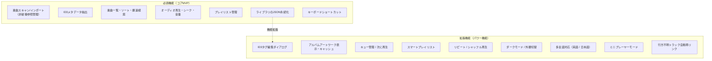
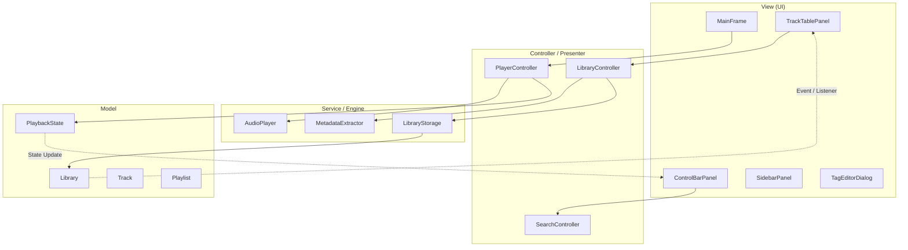
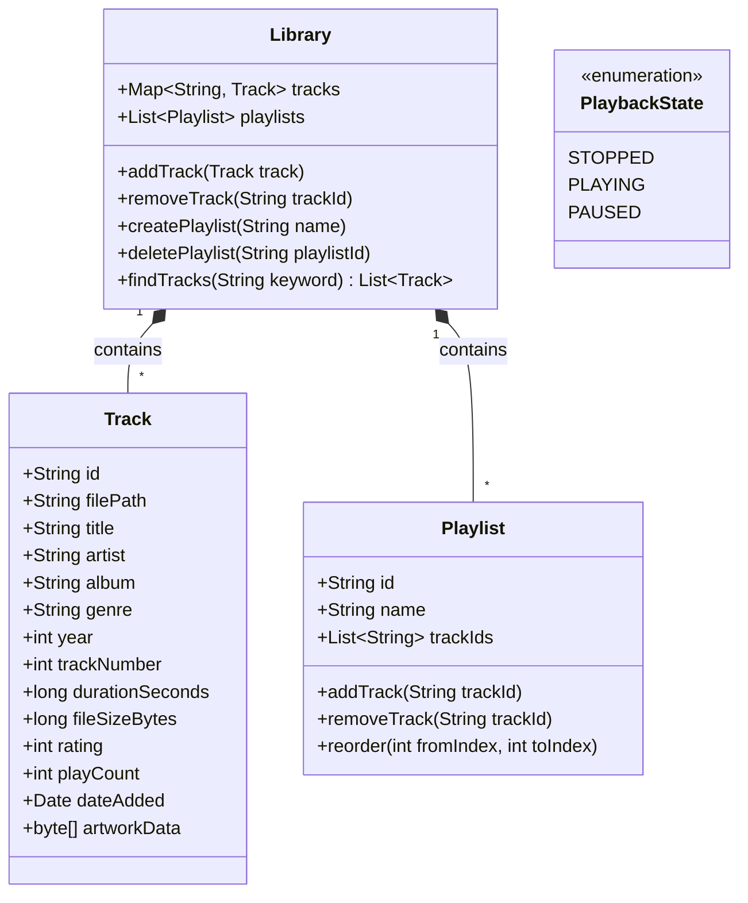
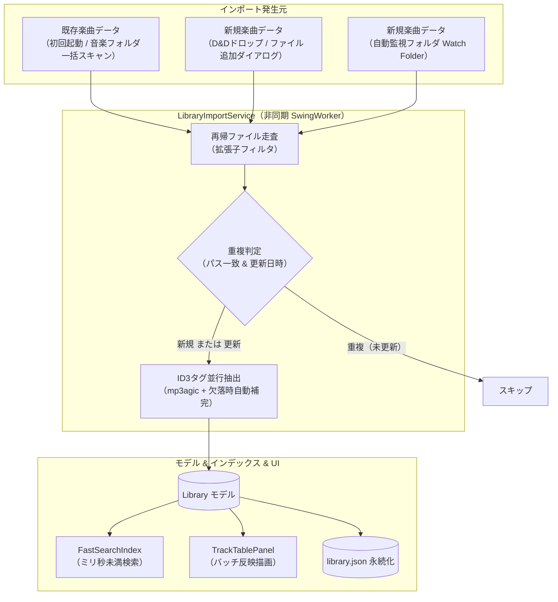
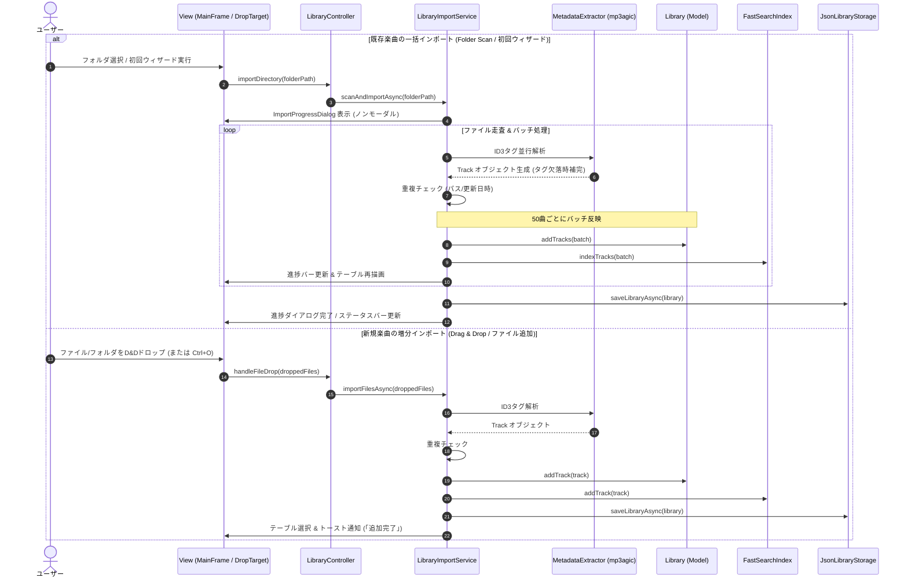
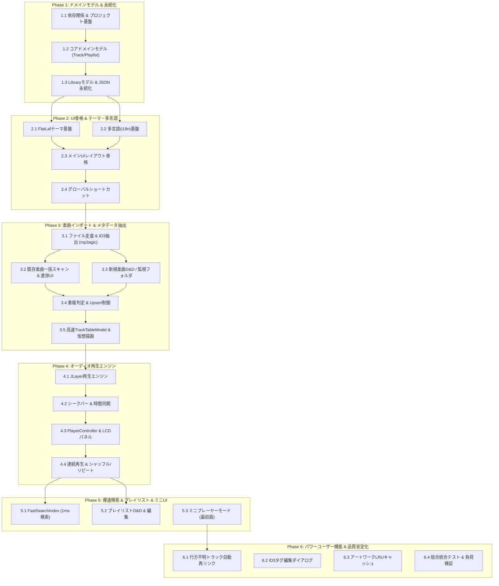

# 音楽データ管理アプリケーション（iTunesライク）基本設計書

## 1. はじめに
本ドキュメントは、Java + Swingを用いてクラシックなiTunesライクなUI/UXを持つデスクトップ向け音楽データ管理・再生アプリケーションを構築するための基本設計書です。

### 1.1 目標
- **iTunes風の洗練されたUI**: 上部プレーヤーバー（LCD風情報表示）、左サイドバー（ライブラリ/プレイリスト一覧）、中央トラックテーブル、下部ステータスバー。
- **直感的な楽曲管理**: 楽曲ファイルのインポート（ドラッグ＆ドロップ、フォルダスキャン）、メタデータ（タグ情報）の抽出・編集、検索・絞り込み。
- **安定した音楽再生**: 再生・一時停止・シーク・音量調整・リピート/シャッフル対応。
- **操作感が爆速であること（ハイパフォーマンスの徹底）**: 数万曲規模のライブラリでもUIが一切カクつかず、検索・ソート・画面描画・楽曲再生が瞬時に反応する軽快な操作感を常に意識した設計・実装を行う（UIスレッド完全非同期化、キャッシュ、効率的なデータ構造、遅延ロード）。
- **堅牢なアーキテクチャ**: MVCパターンを基調とし、保守性・テスタビリティの高い疎結合設計。

### 1.2 iTunesの課題克服と本アプリの差別化改善方針（改善点①〜⑤）
本アプリケーションは、従来のiTunes（特にWindows版）が抱えていた弱点・不満点を根本から解決し、音楽愛好家にとって真に快適な音楽体験を提供することを絶対要件とします：

| 改善点 | 従来のiTunesの課題 | 本アプリでの改善・本機能化方針 |
|---|---|---|
| **① 音楽再生・管理への極限の純化（超軽量・爆速化）** | ストア、映画、ポッドキャスト、iOS端末バックアップ等で肥大化（Bloatware）し動作が重い | 不要な通信・外部同期を完全排除し、**純粋なローカル音楽プレーヤー**に特化。`FastSearchIndex` により数万曲でも1ms未満のインクリメンタル検索を実現。 |
| **② 非破壊ファイル管理ポリシー** | 「ライブラリ整理」により元のフォルダ構造やファイル名を勝手に改変される | ユーザーの元フォルダ構造・ファイル名を**一切改変しない非破壊参照型管理**を徹底。安全なD&Dインポート。 |
| **③ 現代的デスクトップUI（完全ダークモード & HiDPIベクター）** | Windows版はダークモードが不完全、4Kディスプレイで表示がぼやける | **FlatLaf macOS Dark / Light** による即時切替。全アイコンをベクターSVG化し、Retina/4Kでも極上の鮮明さを保証。象徴的な「LCD風ディスプレイ」をモダンに昇華。 |
| **④ オープンで扱いやすいデータ永続化** | 独自バイナリ（`iTunes Library.itl`）で破損しやすく、中身が見えず移行も困難 | **標準JSON形式（Gson）** で保存。軽量・高信頼性で、テキストエディタ閲覧、手動バックアップ、Git管理が容易。 |
| **⑤ パワーユーザー向け必須本機能** | 行方不明ファイル（！）の修復が困難。常駐プレーヤーが重い。マウス操作必須。 | **(1) 行方不明トラックのワンクリック自動検出 & 再リンク**<br>**(2) ミニプレーヤーモード（最前面ピン留め対応の超小型UI）**<br>**(3) フルキーボードショートカット対応（Space再生, Ctrl+F検索, J/Lスキップ）** |

---

## 2. システム要件・スコープ



### 2.1 機能一覧
| カテゴリ | 機能名 | 内容 | 優先度 |
|---|---|---|:---:|
| **ライブラリ** | 既存楽曲データの一括インポート | 指定フォルダを再帰スキャンして対応形式（MP3/WAV等）を一括取り込み（非破壊参照、非同期進捗表示・キャンセル対応） | 高 |
| | 新規楽曲データの増分インポート | ドラッグ＆ドロップ（D&D）、ファイル選択、監視フォルダ（Watch Folder）からの即時増分追加 | 高 |
| | 重複判定・マージ制御 | 同一パスや同一ファイルの重複登録防止、更新タイムスタンプに基づくメタデータUpsert | 高 |
| | メタデータ抽出 & 補完 | タイトル、アーティスト、アルバム、ジャンル、再生時間、アートワークの抽出およびファイル名からの自動補完 | 高 |
| | 永続化（保存/読込） | アプリ終了時およびインポート完了時にライブラリ情報を可読なJSON形式で保存し、次回起動時に復元 | 高 |
| | 爆速検索 & フィルタ | メモリ内インデックスによる1ms未満のリアルタイムインクリメンタル高速検索 | 高 |
| | タグ情報編集 | 曲情報のインスペクター・メタデータ書き換え | 中 |
| | 行方不明トラック再リンク | パス変更やドライブ文字変更によるリンク切れをフォルダ内から自動探索・復旧 | 高 |
| **再生** | 基本再生 | 再生、一時停止、停止、スキップ（前/次の曲） | 高 |
| | プログレス & シーク | 再生位置のリアルタイム表示とシークバー操作 | 高 |
| | 音量調整 | ボリュームスライダーおよびミュート切り替え | 高 |
| | 連続再生 / モード | 自動次曲再生、リピート、シャッフル | 中 |
| **プレイリスト** | 手動プレイリスト | プレイリストの作成、削除、名前変更、ドラッグ＆ドロップでの曲追加 | 高 |
| | お気に入り | ★レーティングやお気に入りフラグ管理 | 低 |
| **外観 / UI** | ダークモード切替 | ライトモード / ダークモードのシームレスなワンクリック切替（FlatLaf Dark / Light） | 高 |
| | ミニプレーヤーモード | 作業用BGM再生に適したコンパクト画面へのワンクリック変形（最前面常駐可能） | 高 |
| **操作性** | キーボードショートカット | 再生/停止(Space)、検索フォーカス(Ctrl+F)、スキップ(J/L)、音量(Ctrl+↑/↓)等の徹底 | 高 |
| **ローカライズ** | 多言語対応 (i18n) | 英語 (en) および日本語 (ja) のシームレスな切り替え対応（ResourceBundle活用、設定永続化） | 高 |

---

## 3. UI/UX 画面レイアウト設計

iTunes（クラシックスタイル）のレイアウトを踏襲します。

### 3.1 画面ワイヤーフレーム

```
+------------------------------------------------------------------------------------------------+
|  [Menu: File(Add File... Ctrl+O, Add Folder..., Rescan Library) / Edit / View / Controls / Help]
+------------------------------------------------------------------------------------------------+
|  [|<] [ >/|| ] [>|]  [Vol: ──O──]  |  [Art]  Title - Artist           | [ Q 検索...   ] [🌙/☀️] |
|                                    |         01:23 ───O─────── 03:45  |                                |
+-------------------------+----------------------------------------------------------------------+
| [ サイドバー ]          | [ メインコンテンツエリア (ファイル/フォルダのD&D受付対応) ]          |
|                         |                                                                      |
| ▼ ライブラリ            |  #  | タイトル        | アーティスト  | アルバム       | 時間  | ジャンル |
|   🎵 すべての曲 (1,240) | -------------------------------------------------------------------- |
|   👤 アーティスト       |  1  | Bohemian Rhap.. | Queen         | A Night at ..  | 05:55 | Rock     |
|   💿 アルバム           |  2  | Shape of You    | Ed Sheeran    | ÷ (Divide)     | 03:53 | Pop      |
|   🕒 最近追加した項目   |  3  | Hotel Californ..| Eagles        | Hotel Califor..| 06:30 | Classic  |
|                         |  4  | Stay            | Justin Bieber | Justice        | 02:21 | Pop      |
| ▼ プレイリスト          |  .. | ...             | ...           | ...            | ...   | ...      |
|   ⭐ お気に入り         |                                                                      |
|   🚗 ドライブ用         |                                                                      |
|   🎧 作業用BGM          |                                                                      |
|                         |                                                                      |
| [+ 新規プレイリスト]    |                                                                      |
+-------------------------+----------------------------------------------------------------------+
|  1,240 曲, 3.8 日間, 14.2 GB  | [インポート進捗ミニ表示: 走査完了]                              |
+------------------------------------------------------------------------------------------------+
```

### 3.2 主要コンポーネント構成
1. **MenuBar（メニューバー）**
   - **File（ファイル）**: `ファイルをライブラリに追加...` (`Ctrl + O`), `フォルダをライブラリに追加...`, `ライブラリフォルダを再スキャン`, `終了`
   - **Edit（編集）**: `元に戻す`, `全選択` (`Ctrl + A`), `環境設定...`（監視フォルダ設定等）
   - **View（表示）**: `テーマ切替` (`Dark / Light`), `言語切替` (`English / 日本語`), `ミニプレーヤー切替` (`Ctrl + M`)
   - **Controls（操作）**: `再生/一時停止` (`Space`), `次の曲`, `前の曲`, `音量アップ/ダウン`
2. **ControlBarPanel（上部）**
   - **トランスポートボタン**: `JButton`（戻る、再生/一時停止、進む）
   - **音量コントローラー**: `JSlider`
   - **LCD ディスプレイ風パネル**: 曲名、アーティスト、アルバム名、再生バー（シーク対応 `JSlider`）、残り時間表示、アートワークサムネイル
   - **爆速検索フィールド**: 入力と同時にテーブルを即時フィルタリングする `JTextField`（インデックス検索・キャッシュ連動）
   - **テーマ切替トグル**: ダークモード / ライトモードをワンクリックでシームレスに切り替える `JButton`（FlatLaf連携）
   - **ミニプレーヤー切替ボタン**: 通常ウィンドウとミニプレーヤーをトグルする `JButton`
3. **SidebarPanel（左側）**
   - ライブラリノード（全曲、アーティスト一覧、アルバム一覧、最近追加）
   - プレイリスト一覧（`JList` または `JTree`）
   - **D&Dターゲット機能**: ファイルやフォルダを特定のプレイリスト上にドロップすると、ライブラリ登録と同時にそのプレイリストへ直ちに追加
   - 下部に「＋」新規プレイリスト作成ボタン
4. **MainContentPanel（中央）**
   - テーブル表示（デフォルト）: `JTable` + `TableRowSorter`
     - **超高速スクロール対応**: 仮想スクロール描画により、数万件の楽曲データでも遅延なく快適に閲覧可能
     - **D&Dターゲット機能**: OSからの音声ファイル/フォルダのドラッグ＆ドロップを全面で受付（視覚的な枠線ハイライト付き）
     - ダブルクリックで即時再生
     - 右クリックコンテキストメニュー（「次に再生」「プレイリストに追加」「プロパティ（情報を見る）」）
   - （オプション）アルバム/アーティストグリッド表示への切り替え
5. **StatusBarPanel（下部）**
   - 選択中または全体の曲数、合計時間、ファイル容量の集計情報表示
   - メタデータ読み込み中やスキャン中のバックグラウンド処理インジケーター表示（クリックで詳細進捗ダイアログを表示）

### 3.3 ミニプレーヤーワイヤーフレーム
作業中の邪魔にならないよう、画面隅（最前面表示対応）に常駐可能な超小型UIを提供します。

```
+--------------------------------------------------------------+
| [Art]  Title - Artist                          [📌] [⤢] [X]  |
|        01:23 ───────────O─────────── 03:45                   |
|        [|<]  [ >/|| ]  [>|]    [Vol: ──O──]                  |
+--------------------------------------------------------------+
```

### 3.4 キーボードショートカット一覧
マウスに手を伸ばさずに全操作を爆速で完結できるキーバインド：

| ショートカットキー | 動作内容 |
|---|---|
| `Space` | 再生 / 一時停止のトグル |
| `Ctrl + F` (`Cmd + F`) | 検索バーへ即座にフォーカス & 全選択 |
| `Ctrl + Right` / `L` | 5秒早送り（スキップ） |
| `Ctrl + Left` / `J` | 5秒巻き戻し |
| `Ctrl + Up` / `Ctrl + Down` | 音量の増減（5%刻み） |
| `Ctrl + M` | ミニプレーヤーモード切替 |
| `Ctrl + T` | ダークモード / ライトモード切替 |
| `Enter` | テーブル選択曲の再生開始 |
| `Delete` | 選択曲のプレイリストからの除外（ファイル実体は保護） |

---

## 4. アーキテクチャ設計

SwingでのGUI構築において、UIの肥大化とイベント地獄を防ぐため、**MVC (Model-View-Controller) + Service/Repositoryパターン**を採用します。



### 4.1 パッケージ構成案
```
src/
└── com/musiclibrary/
    ├── Main.java                        // エントリーポイント、DI/起動処理
    ├── model/                           // ドメインモデル
    │   ├── Track.java                   // 楽曲エンティティ
    │   ├── Playlist.java                // プレイリストエンティティ
    │   ├── Library.java                 // 全体ライブラリモデル
    │   ├── PlaybackState.java           // 再生状態（PLAYING, PAUSED, STOPPED等）
    │   └── listener/                    // イベントリスナー（PlayerListener等）
    ├── service/                         // ビジネスロジック・外部通信
    │   ├── audio/
    │   │   ├── AudioPlayer.java         // オーディオ再生インターフェース
    │   │   └── BasicAudioPlayer.java    // 再生エンジン実装
    │   ├── importer/                    // 楽曲データインポート・監視
    │   │   ├── LibraryImportService.java// 既存/新規楽曲インポート制御（非同期・重複排除）
    │   │   ├── FolderWatcherService.java// 監視フォルダのリアルタイム自動検知
    │   │   └── FileScanner.java         // 再帰的ファイル走査（拡張子フィルタ）
    │   ├── metadata/
    │   │   ├── MetadataExtractor.java   // タグ解析インターフェース
    │   │   └── Mp3MetadataExtractor.java// ID3タグ抽出実装
    │   └── storage/
    │       ├── LibraryStorage.java      // 永続化インターフェース
    │       ├── JsonLibraryStorage.java  // JSON保存・読込実装
    │       └── MissingTrackResolver.java// 行方不明トラックの自動走査・再リンク
    ├── theme/                           // 外観・テーマ管理
    │   └── ThemeManager.java            // FlatLaf ライト/ダークモード切替
    ├── i18n/                            // 多言語対応 (国際化)
    │   └── I18nManager.java             // ResourceBundle管理、言語切替リスナー
    ├── controller/                      // 画面とモデルを調停するコントローラー
    │   ├── PlayerController.java        // 再生操作管理
    │   └── LibraryController.java       // インポート、プレイリスト編集管理
    ├── ui/                              // Swingコンポーネント (View)
    │   ├── MainFrame.java               // メインウィンドウ
    │   ├── MiniPlayerFrame.java         // ミニプレーヤーウィンドウ（最前面ピン留め）
    │   ├── KeyboardShortcutManager.java // キーボード操作管理
    │   ├── dnd/                         // ドラッグ＆ドロップ
    │   │   └── TrackDropTargetListener.java // OSファイル/フォルダD&D受付ハンドラ
    │   ├── panel/
    │   │   ├── ControlBarPanel.java     // 上部コントローラー
    │   │   ├── SidebarPanel.java        // サイドバー
    │   │   ├── TrackTablePanel.java     // 楽曲テーブル
    │   │   └── StatusBarPanel.java      // 下部ステータスバー
    │   ├── dialog/
    │   │   ├── TagEditorDialog.java     // メタデータ編集ダイアログ
    │   │   └── ImportProgressDialog.java// フォルダスキャン進捗（キャンセル/最小化対応）
    │   └── table/
    │       └── TrackTableModel.java     // JTable用モデル
    └── util/                            // ユーティリティ
        ├── TimeFormatter.java           // 秒数 ↔ "03:45" 変換
        ├── FastSearchIndex.java         // メモリ上での爆速インデックス検索
        └── FileUtils.java               // 拡張子判定・ファイル走査
resources/
├── messages_en.properties               // 英語メッセージ定義
└── messages_ja.properties               // 日本語メッセージ定義
```

---

## 5. データモデル設計

### 5.1 クラス設計



### 5.2 各モデルの役割
- **`Track`**: 楽曲メタデータとファイルパスを保持。Artworkのバイナリデータはメモリ圧迫を防ぐため、遅延ロードまたはサムネイルキャッシュを検討。
- **`Playlist`**: 楽曲の実体ではなく`trackId`のリストを保持することで、楽曲情報の同期ズレやメモリ重複を防止。
- **`Library`**: 全TrackとPlaylistの集合。スレッドセーフなコレクションで管理。

---

## 6. 主要モジュールの詳細設計

### 6.1 オーディオ再生エンジン (`AudioPlayer`)
SwingのUIスレッド（EDT: Event Dispatch Thread）をブロックさせないため、**再生処理はバックグラウンドスレッドで実行**します。

- **状態管理**: `STOPPED` $\to$ `PLAYING` $\leftrightarrow$ `PAUSED`
- **再生イベント通知 (`PlayerListener`)**:
  - `onTrackStarted(Track track)`: 曲名、アートワーク、総再生時間をUIに反映
  - `onProgressUpdate(long currentSeconds, long totalSeconds)`: シークバーとタイマーの更新（100ms〜500ms間隔）
  - `onTrackFinished(Track track)`: 自動的に次の曲を再生
  - `onStateChanged(PlaybackState state)`: 再生/一時停止ボタンのアイコン切り替え
- **シーク操作**: ユーザーがスライダーをドラッグ中はイベント発火を一時抑制し、指を離した時点（`mouseReleased`）で目的の位置にジャンプ。

### 6.2 楽曲データインポート・登録設計（既存楽曲／新規楽曲）

本アプリケーションにおける楽曲登録（インポート）は、iTunesの最大の不満点であった「ファイルの勝手な移動・名前変更による破損」や「巨大フォルダ読み込み時のフリーズ」を根本から解決し、**「非破壊参照管理」「UI完全非同期（EDT保護）」「重複排除」「爆速インデックス即時反映」** を基本原則として設計します。



#### 6.2.1 インポート処理の基本設計原則
1. **非破壊参照管理ポリシー**:
   - 楽曲ファイルの実体は移動・コピー・リネームを一切行わず、ユーザーが指定・配置した元のフォルダのまま絶対パス（`filePath`）として安全に参照管理します。
2. **EDT（UIスレッド）完全ブロックゼロ**:
   - ファイル走査、ID3タグ解析（mp3agic）、アートワーク画像デコード、JSON書き込みはすべて `SwingWorker` / バックグラウンドスレッドプールで実行し、UIのカクつきを根絶します。
3. **重複登録の自動防止（Deduplication）**:
   - 同一ファイルの二重登録をスマートに排除し、更新があった場合のみメタデータを更新（Upsert）します。
4. **段階的（バッチ）UI反映**:
   - 全曲の走査完了を待つことなく、50〜100曲単位のバッチでテーブルと `FastSearchIndex` に順次反映し、体感待ち時間をゼロにします。

---

#### 6.2.2 既存楽曲データの登録（初期セットアップ & 一括インポート）
ユーザーがPC内や外付けHDD/NASに保管している大量の既存コレクション（数千〜数万曲）を一括で高速登録するフローです。

##### (1) トリガーおよびユーザー操作
- **初回起動時ウェルカムウィザード**:
  - 初回起動時（ライブラリが空の状態）に「ミュージックライブラリのセットアップ」画面を自動表示。
  - OS標準のミュージックフォルダ（`~/Music`）をデフォルト提案し、ワンクリックで一括インポートを開始可能。カスタムフォルダの選択も可能。
- **メニューバー操作**:
  - `ファイル (File) > フォルダをライブラリに追加...`
  - `ファイル (File) > ライブラリフォルダを再スキャン`（ドライブ文字変更やファイル構成変更後の整合性再同期）

##### (2) 内部処理アーキテクチャ & 高速化
- **再帰的非同期ディレクトリ走査 (`FileScanner`)**:
  - `java.nio.file.Files.walkFileTree` をバックグラウンドスレッドで実行し、巨大な階層フォルダでもミリ秒単位で高速列挙。
  - 対応拡張子（`.mp3`, `.wav`, `.m4a`, `.flac`）のみを高速フィルタリング。
- **並行メタデータ抽出**:
  - 列挙されたファイルをCPUコア数に応じた並行ワーカー（`ForkJoinPool` / `ExecutorService`）で分割し、`mp3agic` を用いて並列にID3タグを解析。
- **インポート進捗ダイアログ (`ImportProgressDialog`)**:
  - ノンモーダルダイアログで表示し、インポート中もUI操作を阻害しない。
  - 表示内容: 「スキャン中: 1,450 / 8,200 曲」「現在のファイル名」＋リアルタイムプログレスバー。
  - **「バックグラウンドで実行」ボタン**: クリックでダイアログを閉じ、下部ステータスバーのミニインジケーター表示にシームレスに移行。
  - **「キャンセル」ボタン**: いつでも安全に中断可能。中断時点までに解析完了した楽曲はライブラリに正常保存される。
- **バッチ更新による描画負荷低減**:
  - 1曲ごとにUIイベントを発火すると描画過負荷になるため、50曲単位（または200ms間隔）で `TrackTableModel.addTracks(List<Track>)` をバッチ呼び出し。
- **一括インデックス構築 & JSON永続化**:
  - 走査完了時に `FastSearchIndex` のメモリインデックスを確定。
  - `LibraryStorageService` により `library.json` に非同期で一括書き込み。

---

#### 6.2.3 新規楽曲データの登録（日常追加 & 増分インポート）
日常的に新しい楽曲を購入・ダウンロード・CDリッピングした際に、1曲〜数曲、またはアルバム単位で手軽にライブラリへ追加するフローです。

##### (1) トリガーおよびユーザー操作
- **① 直感的なドラッグ＆ドロップ（Drag & Drop）**:
  - エクスプローラーやFinderから、単一/複数の音声ファイル、またはアルバムフォルダをアプリ画面に直接ドロップ。
  - **ドロップ先に応じたスマートな動作**:
    - **トラックテーブル（中央メインエリア）にドロップ**: ライブラリ全体（「すべての曲」）に増分追加。
    - **サイドバーの特定プレイリストにドロップ**: ライブラリ全体への増分追加に加え、そのプレイリストの末尾にも自動登録。
  - **視覚的フィードバック (`TrackDropTargetListener`)**:
    - ドラッグ受入可能エリア（テーブルやプレイリスト行）にアクセントカラーの枠線やハイライトを表示。
- **② メニューバー / ショートカットキー**:
  - `ファイル (File) > ファイルをライブラリに追加...`（`Ctrl + O` / `Cmd + O`）
  - ファイル選択ダイアログ（`JFileChooser`、複数選択対応）から目的のファイルを選択して即座に追加。
- **③ 自動監視フォルダ（Watch Folder 機構）**:
  - 設定画面で「自動監視フォルダ」（例: `~/Downloads/Music` やリッピング出力先フォルダ）を登録可能。
  - `java.nio.file.WatchService` がバックグラウンドで常駐し、新規ファイル作成（`ENTRY_CREATE`）を監視。
  - ダウンロード完了判定（ファイルサイズが一定時間静止したことを確認）後、自動でライブラリにサイレント増分登録。

##### (2) 内部処理 & ユーザーフィードバック
- **即時差分登録**:
  - 1曲〜アルバム単位の小規模処理のため、数ミリ秒〜数百ミリ秒で瞬時に解析・登録が完了。
- **「最近追加した項目（Recently Added）」への即時反映**:
  - 追加時のタイムスタンプ（`dateAdded`）を付与し、サイドバーの「最近追加した項目」スマートプレイリストの先頭に即時反映。ユーザーが今追加した新譜を迷わず1クリックで再生可能。
- **検索インデックスの即時更新**:
  - `FastSearchIndex.addTrack(track)` を即時実行（1ms未満）。追加直後から検索バーでインクリメンタル検索にヒット。
- **トースト通知 / ステータスバー表示**:
  - 追加完了時に下部ステータスバーまたは一時的なトースト通知（例:「3曲をライブラリに追加しました」）を表示。

---

#### 6.2.4 重複判定・マージ制御ポリシー（Deduplication）
ファイルの二重登録によるライブラリの重複混乱を防ぐため、以下の判定ルールを厳格に適用します：

| 判定条件 | 状態判定 | アプリケーションの動作 |
|---|---|---|
| **`filePath` が完全一致** かつ **更新日時が同一** | 完全重複 | インポート処理をスキップ（何もしない）。ログ/進捗に「スキップ」カウント加算。 |
| **`filePath` が完全一致** かつ **更新日時が新しい** | 外部タグ更新 | メタデータ（ID3タグ等）を再読み込みし、既存の `Track` 情報を更新（Upsert）。 |
| **`filePath` は異なる** が **タイトル・アーティスト・尺（Duration）・ファイルサイズが完全一致** | 同一曲の別配置 | 環境設定のポリシー（「重複をスキップ」または「別ファイルとして追加」）に基づき判定。デフォルトは重複スキップ。 |

---

#### 6.2.5 メタデータ抽出（mp3agic）とタグ欠落時の自動補完
1. **ID3タグの読み取り**:
   - `mp3agic` を使用し、ID3v1 / ID3v2.2〜v2.4 からタイトル、アーティスト、アルバム、トラック番号、ジャンル、発売年、曲の長さ（Duration）を取得。
2. **タグ欠落時のスマート自動補完**:
   - タイトルタグが空の場合: ファイル名からトラック番号や拡張子を除去してタイトルに設定（例: `03 - Bohemian Rhapsody.mp3` $\to$ `Bohemian Rhapsody`）。
   - アーティスト/アルバムタグが空の場合: 親フォルダ名から推定補完（例: `.../Queen/A Night at the Opera/03.mp3` $\to$ アーティスト: `Queen`, アルバム: `A Night at the Opera`）。
3. **埋め込みアートワーク（アルバム画像）の最適化**:
   - `mp3agic.getId3v2Tag().getAlbumImage()` から画像バイト列を抽出。
   - メモリ枯渇（OutOfMemoryError）を防ぐため、フル解像度画像はオンデマンド読込とし、メモリ上にはテーブル/LCD表示用の軽量サムネイル（64x64, 128x128）のみをLRUキャッシュで保持。

---

#### 6.2.6 インポート処理のシーケンス図



### 6.3 永続化設計 (Persistence)
- **保存形式**: JSON 形式（可読性と軽量性を両立）
  - 保存先: ユーザーホームディレクトリ配下（例: `~/.musiclibrary/library.json`）またはプロジェクト直下。
  - アプリ起動時に読み込み、楽曲追加・編集・削除時またはアプリ終了時にバックグラウンドで書き込み。

### 6.4 ダークモード & テーマ管理 (`ThemeManager`)
- **シームレスなテーマ切替**:
  - `FlatLaf` の `FlatMacDarkLaf`（ダークモード）と `FlatMacLightLaf`（ライトモード）を採用。
  - アプリの再起動を必要とせず、実行中に `FlatLaf.setup()` と `FlatLaf.updateUI()` を呼び出して全ウィンドウ・ダイアログの配色を一瞬で切り替え。
- **テーマ設定の永続化**:
  - ユーザーが選択したテーマ（Dark / Light / システム追従）を永続化ファイルに記録し、次回起動時に自動適用。
- **高視認性・高コントラスト**:
  - LCDプレーヤー風パネルやテーブルの選択行、シークバー等もダーク/ライト両環境で最適なコントラストを維持。

### 6.5 爆速操作感のための高速化・パフォーマンス設計
「数万曲のライブラリでも一切カクつかず、瞬時に反応する」を実現するための設計方針：
1. **EDT（Event Dispatch Thread）の完全ブロック禁止**:
   - 音声再生、ファイルスキャン、ID3タグ解析、JSON保存/読込、画像デコードはすべて別スレッド（`SwingWorker` / `ExecutorService`）で実行。
2. **メモリ内爆速検索インデックス (`FastSearchIndex`)**:
   - タイトル・アーティスト・アルバム・ジャンルを事前にトークン化・小文字化した転置インデックス（またはプレフィックスツリー）をメモリ上に構築。
   - 1文字タイプするごとに数万件の中からミリ秒未満（< 1ms）で該当トラックIDを高速抽出し、テーブルへ即時反映。
3. **テーブル仮想化・遅延レンダリング**:
   - `JTable` のカスタムセルレンダラーでの不要なインスタンス生成を排除。
   - アートワーク（画像）はメモリキャッシュ（LRUキャッシュ）で管理し、テーブルスクロール時にはプレースホルダーを即時表示しつつバックグラウンドでサムネイルを遅延ロード。
4. **差分更新による描画負荷低減**:
   - 大量データ追加時は一括イベント発火（バッチ更新）を行い、UI再描画の頻度を最小化。

### 6.6 多言語対応（i18n）設計 (`I18nManager`)
- **標準国際化機構の採用**:
  - `java.util.ResourceBundle`（UTF-8プロパティファイル）と `java.util.Locale` を用いた堅牢な設計。
  - 初期対応言語: **日本語 (`ja`)** と **英語 (`en`)**。
- **シームレスな動的言語切替**:
  - メニューバー（`View > Language > English / 日本語`）からワンクリックで切り替え可能。
  - `LanguageChangeListener` を通じて、登録されたUIコンポーネント（メニュー、ボタン、テーブルヘッダー、ステータスバー等）のテキストを一括更新。
- **設定の永続化**:
  - ユーザーが選択した言語（ja / en / システムデフォルト追従）を設定ファイルに保存し、次回起動時に自動復元。
- **リソース構成**:
  - `messages_en.properties`: 英語リソース
  - `messages_ja.properties`: 日本語リソース

### 6.7 行方不明トラックの自動検出 & 再リンク (`MissingTrackResolver`)
従来のiTunesで最大のストレス源だった「ファイルが見つからない（！マーク）」を自動リカバリする機能：
- **非破壊ファイルポリシーの維持**:
  - アプリ側はファイルの実体移動やリネームは一切行わず、あくまで参照パス（`filePath`）のみを管理。
- **リンク切れの検知**:
  - 再生時またはライブラリ整合性チェック時に `new File(track.getFilePath()).exists()` で判定。
- **自動再リンク処理**:
  - ユーザーが指定したフォルダ（または元の親フォルダ）をバックグラウンドで走査。
  - ファイル名の一致、ファイルサイズ、楽曲再生時間（Duration）、ID3タグ（タイトル＋アーティスト）の合致度から同一ファイルを特定し、ライブラリのパスを自動修正。

### 6.8 ミニプレーヤーモード (`MiniPlayerFrame`)
- **シームレスなモード変形**:
  - `Ctrl + M` またはプレーヤーバーの変形ボタンで、`MainFrame` を非表示にし、超軽量な `MiniPlayerFrame` を表示（逆も同様）。
  - 再生状態、音量、シーク位置は同一の `PlayerController` を共有するため途切れることなくそのまま引き継がれる。
- **最前面固定（Always on Top）**:
  - ピン留めアイコンにより `setAlwaysOnTop(true)` をトグル可能。作業用BGMプレーヤーとしてデスクトップの隅に常駐。

### 6.9 グローバルキーボードショートカット (`KeyboardShortcutManager`)
- **Swing KeyStroke + ActionMap による高速処理**:
  - フォーカスがどこにあっても（テーブル選択中、検索中以外など）`Space` キーで即座に再生/一時停止。
  - `Ctrl + F` で検索バーへジャンプし、タイピングと同時に即座にインデックス検索が走る直感操作を実現。

---

## 7. 技術選定 & 外部ライブラリ導入方針

### 7.1 ライブラリ積極導入方針
**車輪の再発明を避け、品質・安定性・堅牢性・開発速度を最大限に高めるため、実績のある高品質なオープンソース外部ライブラリを積極的に導入します。**

| 領域 | 採用ライブラリ | 選定理由・役割 |
|---|---|---|
| **ビルドツール** | **Gradle** | 依存関係の自動解決、JUnitテスト自動実行、ビルドキャッシュによる高速ビルド |
| **MP3再生エンジン** | **JLayer (JavaZoom)** | JavaにおけるMP3デコードの標準デファクト。低負荷・高安定性 |
| **ID3メタデータ解析・編集** | **mp3agic** | ID3v1/ID3v2.2〜v2.4対応。タグの読み書き、埋め込みアートワーク抽出が高精度 |
| **モダンUI Look & Feel** | **FlatLaf** + **FlatLaf Mac Themes** | 洗練されたmacOS風UI。ライトモード/ダークモードの即時切替に対応 |
| **ベクターアイコン** | **FlatLaf Extras (FlatSVGIcon)** | SVGベクターアイコンの利用により、HiDPI/Retinaディスプレイでも劣化のない爆速描画 |
| **永続化 (JSON)** | **Google Gson** | 軽量・高速で堅牢なJSONシリアライザ。ライブラリデータの保存・復元 |
| **共通ユーティリティ** | **Apache Commons IO** / **Lang3** | 安全で高速なファイル走査、NULL安全な文字列・コレクション操作 |
| **テストフレームワーク** | **JUnit 5 (Jupiter)** + **AssertJ** | 網羅的で表現力の高い単体テスト・回帰テストの実現 |

---

## 8. 実装ロードマップ（段階的開発ステップ）

本ロードマップは、[AGENTS.md](../AGENTS.md) に基づき、Orchestratorが各エージェント（Developer / Tester / Reviewer）へ安全かつ小刻みにタスクを割り振れるよう、Phase 1〜6 を具体的なサブタスク（Step）単位に細分化したものです。



---

### 8.1 各Phaseの詳細サブタスク一覧

#### Phase 1: 開発環境整備 & ドメインモデル・永続化基盤
| サブタスク | 開発対象クラス / リソース | 実装内容 (Developer) | テスト検証項目 (Tester) | 完了基準 (Reviewer) |
|---|---|---|---|---|
| **Phase 1.1**<br>プロジェクト基盤 & ビルド環境整備 | `build.gradle`, ディレクトリ構造 | Java 21, FlatLaf, mp3agic, JLayer, Gson, Commons IO, JUnit 5, AssertJ の依存解決と基本パッケージ構築 | `./gradlew test` のクリーン実行確認 | ビルド警告ゼロ、不要な依存関係の排除 |
| **Phase 1.2**<br>コアドメインモデルの実装 | `Track.java`<br>`Playlist.java`<br>`PlaybackState.java` | 楽曲エンティティ（イミュータブル考慮、バリデーション、防御的コピー）、プレイリスト（ID参照リスト）、再生状態Enum | 必須プロパティ保持、境界値テスト、不正値例外テスト | Swing非依存なPOJO設計、Null安全性の担保 |
| **Phase 1.3**<br>ライブラリモデル & JSON永続化 | `Library.java`<br>`LibraryStorage.java`<br>`JsonLibraryStorage.java` | ライブラリCRUD操作（スレッドセーフなコレクション）、Gsonを用いたJSON保存・復元、アトミックファイル書き込みによる破損防止 | 保存したJSONの完全復元検証、日本語パス・特殊文字のエスケープ検証 | 破損耐性（一時ファイルからのリネーム置換）、可読性 |

---

#### Phase 2: UI基盤 & 外観テーマ・多言語基盤
| サブタスク | 開発対象クラス / リソース | 実装内容 (Developer) | テスト検証項目 (Tester) | 完了基準 (Reviewer) |
|---|---|---|---|---|
| **Phase 2.1**<br>FlatLafテーマ管理基盤 | `ThemeManager.java` | FlatMacDarkLaf / FlatMacLightLaf の動的切替、設定ファイルへのテーマ保存・次回復元 | テーマ切替時の例外非発生、設定永続化の読込テスト | UI再起動なしでの即時反映（`updateUI()`） |
| **Phase 2.2**<br>多言語 (i18n) 基盤 | `I18nManager.java`<br>`messages_en.properties`<br>`messages_ja.properties` | `ResourceBundle` 管理、ロケール変更リスナー機構、英語/日本語プロパティファイルの完全なキー同期 | キー抜け検知テスト、言語切替イベント発火テスト | ハードコード文字列の排除、UTF-8整合性 |
| **Phase 2.3**<br>メインUIレイアウト骨格 | `MainFrame.java`<br>`ControlBarPanel.java`<br>`SidebarPanel.java`<br>`TrackTablePanel.java`<br>`StatusBarPanel.java` | クラシックiTunesスタイルの3ペイン構成（上部操作/LCD、左サイドバー、中央テーブル、下部ステータスバー）とメニューバー構築 | 各パネルの配置整合性、ウィンドウリサイズ時の伸縮性 | EDT上での安全な初期化、コンポーネントの疎結合性 |
| **Phase 2.4**<br>グローバルキーボード操作 | `KeyboardShortcutManager.java` | Swing KeyStroke / ActionMap による Space(再生/停止)、Ctrl+F(検索)、Ctrl+M(ミニ)、Ctrl+T(テーマ) 等の実装 | 各ショートカットキーのイベント受信・委譲確認 | フォーカス位置に依存しない確実なキー捕捉 |

---

#### Phase 3: 楽曲インポート・メタデータ抽出 & 高速テーブル表示
| サブタスク | 開発対象クラス / リソース | 実装内容 (Developer) | テスト検証項目 (Tester) | 完了基準 (Reviewer) |
|---|---|---|---|---|
| **Phase 3.1**<br>ファイル走査 & メタデータ抽出 | `FileScanner.java`<br>`MetadataExtractor.java`<br>`Mp3MetadataExtractor.java` | `Files.walkFileTree` による非同期再帰走査、`mp3agic` によるID3v1/ID3v2解析、タグ欠落時のファイル名・フォルダからの自動補完 | 多様なMP3タグ（ID3v1, v2.3, v2.4, タグなし）の抽出精度検証 | 解析失敗時の例外握りつぶし防止とフォールバック保証 |
| **Phase 3.2**<br>既存楽曲の一括インポート & 進捗UI | `LibraryImportService.java`<br>`ImportProgressDialog.java` | `SwingWorker` によるバックグラウンド一括インポート、ノンモーダル進捗ダイアログ、バックグラウンド縮退、キャンセル処理 | 1,000ファイル以上の走査、キャンセル時の中断と整合性検証 | EDTブロックゼロの確認、進捗表示のスムーズさ |
| **Phase 3.3**<br>新規楽曲の増分インポート | `TrackDropTargetListener.java`<br>`FolderWatcherService.java` | OSからのD&D（メインテーブル/サイドバープレイリスト）、ファイル追加ダイアログ（`Ctrl+O`）、`WatchService` によるフォルダ監視 | 単一/複数ファイルD&D、フォルダD&D、ファイル追加イベント検知検証 | D&D時の視覚的枠線ハイライト、即時追加の快適さ |
| **Phase 3.4**<br>重複判定 & マージ制御 | `LibraryImportService.java` (重複判定) | 同一パスのスキップ、更新日時変更時のメタデータUpsert、同一曲判定ポリシー | 重複ファイル連続インポート時のスキップ検証、更新時Upsert検証 | ライブラリ内の重複レコード発生防止 |
| **Phase 3.5**<br>超高速テーブル表示 & バッチ反映 | `TrackTableModel.java`<br>`TrackTablePanel.java` | 50曲単位のバッチ更新（描画負荷抑制）、ソート（`TableRowSorter`）、ステータスバー集計（曲数・時間・容量） | 大量データバッチ追加時の描画パフォーマンス、ソート動作検証 | スクロール追従性、仮想描画による軽量動作 |

---

#### Phase 4: オーディオ再生エンジン & コントロール連携
| サブタスク | 開発対象クラス / リソース | 実装内容 (Developer) | テスト検証項目 (Tester) | 完了基準 (Reviewer) |
|---|---|---|---|---|
| **Phase 4.1**<br>MP3再生エンジン実装 | `AudioPlayer.java`<br>`BasicAudioPlayer.java` | JLayerを用いたバックグラウンドスレッド再生、再生/一時停止/停止、音量調整（ゲインコントロール） | 再生状態遷移（STOPPED $\to$ PLAYING $\leftrightarrow$ PAUSED）、音量変更テスト | 再生中のEDT非同期性、スレッド破棄とリソース解放 |
| **Phase 4.2**<br>シークバー & プログレス同期 | `TimeFormatter.java`<br>`PlayerListener.java` | フレーム位置計算、100〜200ms周期の再生進捗イベント発火、シークバーのマウスリリース時ジャンプ | シーク位置と再生時間の一致、時間フォーマット変換テスト | スライダー操作中のUIチラつき・イベント競合防止 |
| **Phase 4.3**<br>PlayerController & LCD連携 | `PlayerController.java`<br>`ControlBarPanel.java` | UIトランスポートボタン、ボリューム、LCD風パネル（曲名・アーティスト・アートワーク・残り時間）の双方向バインド | コントローラーイベントによる再生操作・表示更新の検証 | モデル・ビューの分離度、リスナーの適切な登録・解除 |
| **Phase 4.4**<br>連続再生 & 再生モード | `PlayerController.java`<br>`PlayQueue.java` (内部管理) | 再生完了時（`onTrackFinished`）の自動次曲再生、リピート（全曲/1曲/OFF）、Fisher-Yatesシャッフル再生 | 終端到達時の次曲遷移、シャッフル時の全曲網羅・非重複テスト | キュー状態の整合性、再生リスト変更時の安全な追従 |

---

#### Phase 5: プレイリスト管理 & 爆速検索インデックス & ミニプレーヤー
| サブタスク | 開発対象クラス / リソース | 実装内容 (Developer) | テスト検証項目 (Tester) | 完了基準 (Reviewer) |
|---|---|---|---|---|
| **Phase 5.1**<br>爆速検索インデックス | `FastSearchIndex.java`<br>`SearchController.java` | タイトル/アーティスト/アルバムの転置インデックス構築、ミリ秒未満（< 1ms）のインクリメンタル検索 | 10,000曲インデックス検索の応答速度（< 1ms）、部分一致・大文字小文字無視テスト | タイピングに瞬時に追従する爆速性、メモリフットプリント |
| **Phase 5.2**<br>プレイリスト管理 & D&D楽曲追加 | `LibraryController.java`<br>`SidebarPanel.java` | プレイリスト新規作成/削除/リネーム、トラックテーブルからサイドバーへのD&D曲追加、並び替え | プレイリストCRUD、楽曲追加・削除時のTrack ID参照整合性検証 | 同一曲の複数プレイリスト所属時のメモリ重複排除 |
| **Phase 5.3**<br>ミニプレーヤーモード | `MiniPlayerFrame.java` | 通常ウィンドウ $\leftrightarrow$ ミニプレーヤーのワンクリック変形（`Ctrl+M`）、最前面固定ピン留め（`Always on Top`） | モード切替時の再生継続性、ピン留めトグルテスト | ウィンドウ切替時のちらつき防止、コントローラー状態同期 |

---

#### Phase 6: パワーユーザー機能 & 品質ブラッシュアップ & 安定化
| サブタスク | 開発対象クラス / リソース | 実装内容 (Developer) | テスト検証項目 (Tester) | 完了基準 (Reviewer) |
|---|---|---|---|---|
| **Phase 6.1**<br>行方不明トラック自動再リンク | `MissingTrackResolver.java` | 存在しないファイルのリンク切れ検知（！表示）、指定フォルダ走査とメタデータ照合（タイトル・アーティスト・尺）による自動パス復旧 | 移動されたファイルの自動検出・再リンク成功率テスト | 元ファイルの非破壊性の維持、誤マッチング防止 |
| **Phase 6.2**<br>ID3タグ編集ダイアログ | `TagEditorDialog.java` | メタデータ編集（タイトル、アーティスト、アルバム、年、ジャンル、トラック番号）、mp3agic書き戻しとライブラリ即時同期 | 単一曲および複数曲一括編集テスト、ファイル書き戻し整合性 | ファイル書き込み失敗時のロールバック、テーブル即時更新 |
| **Phase 6.3**<br>アートワークLRUキャッシュ | `ArtworkCache.java` (新設) | 埋め込み画像のオンデマンドデコード、サムネイル（64x64 / 128x128）のLRUメモリキャッシュ、ディスクキャッシュ | キャッシュヒット率、メモリ上限超過時の自動退避テスト | 巨大ライブラリ閲覧時のヒープメモリ圧迫防止 |
| **Phase 6.4**<br>総合統合テスト & 負荷検証 | 全モジュール | 10,000曲規模でのスクロール・検索・連続再生・テーマ切替ストレステスト、全単体/結合テスト一括実行 | テスト全件GREEN、メモリリーク有無のプロファイリング | AGENTS.md規約に基づく全品質審査クリア |

---

## 9. 確定事項と開発体制
本プロジェクトは、[AGENTS.md](../AGENTS.md) に定義された運用規約に基づき、以下の確定方針で進行します：
1. **実行基盤**: **Java 21 (LTS)** を採用（パターンマッチング、Record、仮想スレッドなど最新機能と高性能な実行環境を活用）。
2. **ビルドツール**: **Gradle 8.10.2** を採用し、ビルド・依存管理・JUnitテストを自動化。
3. **外部ライブラリ**: JLayer, mp3agic, FlatLaf, Gson等を積極的に活用し、製品品質のコードを構築。
4. **UX目標**: 「爆速の操作感」、「ダークモード対応」、「多言語対応（英語/日本語）」を設計・実装の柱として徹底。
5. **エージェント体制**: Developer（実装） $\to$ Tester（テスト） $\to$ Reviewer（レビュー）のサイクルで厳密に進行。
